<picture>
  <source media="(prefers-color-scheme: dark)" srcset="assets/hero-dark.svg">
  
</picture>

### Hi, I'm Peyton. I turn app ideas into products you can actually run.

You have an idea for an app, a tool your business keeps wishing it had, or a spreadsheet that badly wants to be software. **quast.io** takes it from *idea* to a **live, working product**: designed, built, secured, deployed, and documented well enough to hand to someone else.

I've spent 20+ years building network infrastructure for trading floors, enterprises and cloud interconnects, where downtime is measured in dollars per second. I build software the same way: boring where it should be boring, tested where it matters, and observable from day one.

<br>

| &nbsp;`01`&nbsp; **Shape it** | &nbsp;`02`&nbsp; **Build it** | &nbsp;`03`&nbsp; **Run it, or hand it off** |
|:--|:--|:--|
| A one-page brief, then a plan: who it's for, what it must do, what it costs to run. Flows and screens before code. | Real code on a modern, low-cost stack. An AI-forward crew does most of the building; I hold every gate. | A release pipeline, backups, alerting, and a handoff doc. Keep me on to run it, or take the keys. |

<br>

## Selected work

> Most client repos stay private. The products are real, and I'm happy to walk through any of them.

#### 🟢 Mountain House Tech · *live* · [mountainhouse.tech](https://mountainhouse.tech)
A complete web platform for a home and small-business tech services company: a public site with service tiers and lead capture, and a customer + staff portal for orders, invoicing, inventory, purchase orders and vendors. Payments run through Stripe, email through Resend, and live updates over WebSockets. Releases go local → preview → prod behind a gated pipeline, with nightly encrypted backups and restore drills.

`SvelteKit` `Cloudflare Pages` `D1` `Durable Objects` `Stripe` `Resend` `GitHub Actions`

#### 🧪 SecondBrain · *in the lab*
A personal operating system: one place where thoughts, reminders and projects from calendar, email, notes and chat turn into action items and dashboards. It's also the first product built end to end on the factory below.

#### 🧪 quast.io · *in the lab*
The firm's own site and intake: describe your idea, get a scoped brief back.

<br>

## How it gets built

<picture>
  <source media="(prefers-color-scheme: dark)" srcset="assets/factory-dark.svg">
  
</picture>

Every product runs through the same seven stations. Each one has a written definition of done and a human gate. Agents propose, humans approve, the app writes. When a mistake gets made, the fix lands in the template or a CI check, so the next product starts out smarter.

<br>

## Stack I reach for

```
web       SvelteKit · TypeScript · HTML/CSS that respects the user
platform  Cloudflare (Pages, Workers, D1, R2, Durable Objects) · Docker
code      Python · Go · Bash
ops       GitHub Actions · n8n · Jira
network   BGP · OSPF · MPLS · AWS Transit Gateway / Direct Connect · SD-WAN
agents    Claude, run as a crew with names, roles and gates
```

<br>

## Have an idea?

**[quast.io](https://quast.io)** · **peyton@quast.io** · Evergreen, Colorado

<sub><code>{quast.IO}_</code> &nbsp;·&nbsp; .IO = I/O: idea in, product out.</sub>
