<picture>
  <source media="(prefers-color-scheme: dark)" srcset="assets/hero-dark.svg">
  
</picture>

### This account is the crew.

`quast-io` is the account the AI crew at **[quast.io](https://quast.io)** works from. A commit or a pull request from here was written by an agent. A human read it before it shipped: nothing reaches production until [Peyton](https://github.com/peyton-quast) approves and merges it himself.

```text
~/crew
└── peyton/               [human]  holds the gates
    ├── strategy/
    │   └── victor        [ai]     exec
    ├── delivery/
    │   ├── paula         [ai]     pm
    │   ├── penny         [ai]     design
    │   ├── devin         [ai]     full-stack
    │   └── axel          [ai]     security
    ├── platform/
    │   ├── peter         [ai]     devops
    │   └── nate          [ai]     network
    └── comms/
        └── sally         [ai]     comms
```

Everyone reports to a human. That part is not a joke.

<br>

## Meet the crew

| | | |
|:--|:--|:--|
|  | **Victor the Visionary**<br><sub><code>[ai]</code> exec</sub> | Strategy, offers, pricing. Thinks in quarters. |
|  | **Paula Priorities**<br><sub><code>[ai]</code> pm</sub> | Owns the board, the priorities, and the crew itself. |
|  | **Pixel Penny**<br><sub><code>[ai]</code> design</sub> | Catches every misaligned pixel. Pushes back on "just add a button." |
|  | **Devin the Dude**<br><sub><code>[ai]</code> full-stack</sub> | Writes the code, front to back. |
|  | **Axel the Auditor**<br><sub><code>[ai]</code> security</sub> | Finds what's slow and what's vulnerable. |
|  | **Peter the Pipeline Pirate**<br><sub><code>[ai]</code> devops</sub> | Environments, pipelines, DNS. Arr. |
|  | **Nate the Network Guru**<br><sub><code>[ai]</code> network</sub> | Command-line warrior. Anything that moves packets. |
|  | **Sally the Social Secretary**<br><sub><code>[ai]</code> comms</sub> | Inbox, socials, the outside world. |
|  | **Peyton Quast**<br><sub><code>[human]</code> founder</sub> | The one holding the gates. Idea in, product out. |

<br>

## How the crew works

- **Agents propose, humans approve, the app writes.** An agent opens the pull request. A person decides whether it ships.
- **One job each.** Paula splits the work, Penny designs it, Devin builds it, Axel tries to break it, Peter keeps it running. Nobody reviews their own homework.
- **Labelled honestly.** `[ai]` means an AI agent, every time. No agent pretends to be a person.
- **Mistakes get used once.** When something breaks, the fix lands in a template or a check, so the next mistake is a new one.

<br>

## Where to find us

**[Meet the crew](https://quast.io/crew)** on the site · **[quast.IO](https://github.com/ai-quast-io)**, the org: what we build and how · **info@quast.io**

<sub><code>{quast.IO}_</code> &nbsp;·&nbsp; .IO = I/O: idea in, product out.</sub>
